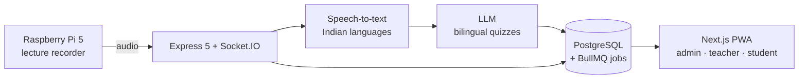

  <picture>
    <source media="(prefers-color-scheme: dark)" srcset="./assets/hero-dark.svg">
    <source media="(prefers-color-scheme: light)" srcset="./assets/hero-light.svg">
    
  </picture>

Chennai · B.E. CSE '29 at Sathyabama (CGPA 8.76) · ML Developer Intern at BenX Solutions

I build software that gets used: a classroom that writes its own quizzes from the lecture, a journal that remembers, a browser extension people keep their streaks in. TypeScript and Postgres by default, Python or Kotlin when the problem needs them. I use AI coding agents heavily. Architecture, tests and review are mine.

## Selected work

- **ClassIQ** (BenX Solutions, private repo): AI classroom platform. A Raspberry Pi records the lecture, Indian-language speech-to-text and an LLM turn it into bilingual quizzes, and a multi-school admin console runs it. *Team of 4, 500+ tests, CI/CD.* `TypeScript` `Postgres` `BullMQ` `Next.js`
- **[Solace](https://github.com/NINJA981/Solace-Diaries)** ([live](https://solace-diaries.vercel.app)): a private journal you can question. Semantic search with pgvector, answers that cite your own entries. *About 330 tests, durable job queue, row-level security.* `React` `Express` `Postgres` `Gemini`
- **[LeetX Squads](https://github.com/NINJA981/LeetX)**: browser extension that turns LeetCode into a habit you keep with friends: streaks, spaced review, squads, 1v1 duels. *Firebase rules tested on the emulator, about 80 tests, releases built by CI for Chrome and Firefox.* `JavaScript` `Firebase`
- **[CryptoTrace](https://github.com/NINJA981/cryptotrace)** ([live](https://cryptotrace-sand.vercel.app)): traces unknown crypto wallets to the exchange that likely holds them, with explainable scoring. *Built solo for Smart India Hackathon.* `FastAPI` `Next.js`
- **JARVIS** (private repo, demo on request): voice-first AI layer for Windows. One router across Claude, OpenAI, Gemini and Ollama, a permission gate on every action, 11 MCP tool servers, an Android companion. *Built with AI coding agents, 1,100+ tests.* `TypeScript` `Electron`

<b>How ClassIQ turns a lecture into a quiz</b>

## Also built

- **VisionNav**: Android navigation for blind and low-vision pedestrians, on-device YOLOv8n hazard detection. 500+ unit tests on the core; field testing in progress.
- **[VADA](https://github.com/NINJA981/vada)**: voice-native RAG with hybrid retrieval and an "is this answerable?" gate, benchmarked for recall and latency.
- **SafeCanteen**: canteen pre-ordering where money and capacity rules live in the database. Tested with 200 students racing for 20 portions.
- **[ORION 1.0](https://github.com/NINJA981/orion-1.0)** ([live](https://orion-sathyabama.vercel.app)): registration and Razorpay payments for a 24-hour national hackathon.
- **[ResponSync](https://github.com/NINJA981/RS)**: AI digital twin for flood response. I built the backend.

## Client work

- **NCS Santhanam** (silk sarees): store, admin and background worker. Razorpay webhooks, oversell-safe stock, Terraform and CI/CD with rollback.
- **Methagu Karuppatti** (palm jaggery): bilingual English/Tamil store. Razorpay and COD, GST invoices, Playwright end-to-end tests.

## Stack

**Languages** TypeScript, Python, Java, Kotlin, SQL, C  
**Web** React, Next.js, Node, Express, Fastify, Tailwind  
**Data** PostgreSQL (pgvector), Redis, BullMQ, Supabase, SQLite, Firebase  
**AI** OpenAI, Gemini, Claude and Ollama APIs, RAG, speech-to-text, MCP, n8n  
**Infra** Docker, GitHub Actions, Cloudflare, Vercel, Raspberry Pi, Linux

## Recognition

1st at Hack the Vibe and Code in the Dark. 2nd at ProtoTech and PromptCraft. 3rd at Aurora. Special Mention at Rush Hour. Luminary Award, sole all-rounder of the first-year batch. Instructor for an n8n workshop, speaker at WebXplore, organiser of CodeStorm and Crackathon.

## Contact

[Email](mailto:saicharan312008@gmail.com) · [LinkedIn](https://www.linkedin.com/in/sai-charan111/) · [Portfolio](https://saicharan-web.pages.dev) · [LeetCode](https://leetcode.com/NINJA981/) · [Resume (PDF)](https://saicharan-web.pages.dev/Sai_Charan_CV.pdf)
