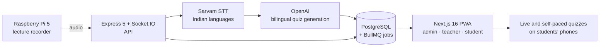
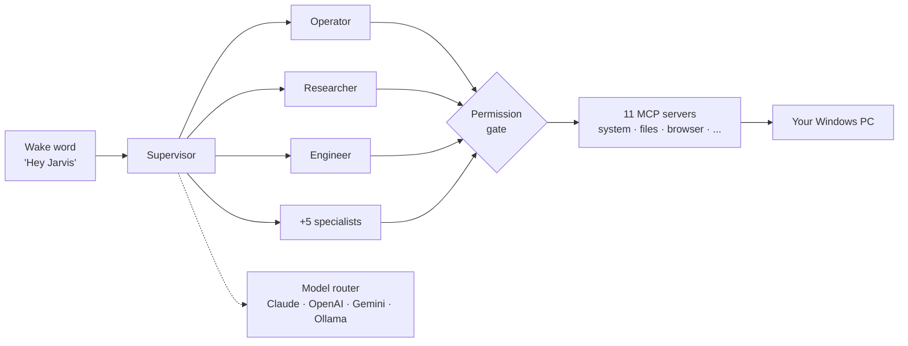
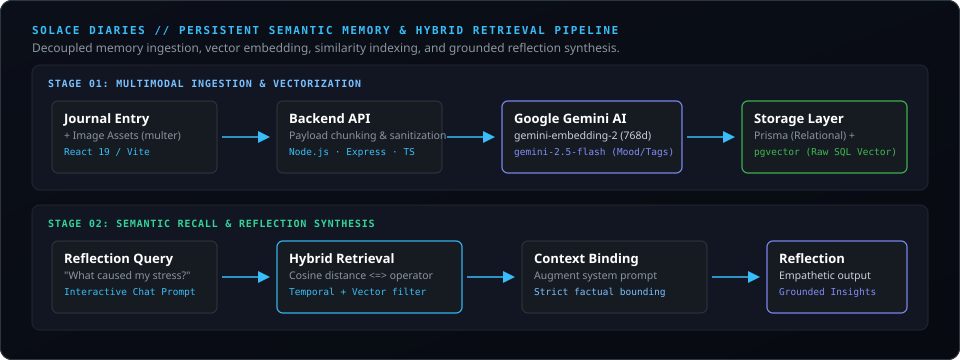

<div align="center">


<a href="https://saicharan-web.pages.dev">
  
</a>

<p>
  <a href="https://saicharan-web.pages.dev"></a>
  <a href="https://www.linkedin.com/in/sai-charan111/"></a>
  <a href="https://leetcode.com/NINJA981/"></a>
  <a href="mailto:saicharan312008@gmail.com"></a>
  <a href="https://saicharan-web.pages.dev/Sai_Charan_CV.pdf"></a>
</p>

<p>
  
  
  
  
</p>

<sub><a href="#-about">About</a> · <a href="#-featured-work">Featured work</a> · <a href="#-how-it-works">How it works</a> · <a href="#-client-work">Client work</a> · <a href="#-stack">Stack</a> · <a href="#-wins--community">Wins</a> · <a href="#-activity">Activity</a> · <a href="#-lets-talk">Contact</a></sub>

</div>

> [!NOTE]
> **I'm looking for an on-site software / AI engineering internship in Chennai.** If you are building with LLMs, voice, or edge hardware, I would love to help. [Message me](mailto:saicharan312008@gmail.com) or [connect on LinkedIn](https://www.linkedin.com/in/sai-charan111/).

---

## 👋 About

Second-year CSE student at **Sathyabama Institute of Science and Technology** and **ML Developer Intern at BenX Solutions**. I turn ideas into working systems. I care most about software that real people use: a classroom running on a Raspberry Pi, a store taking real payments, a journal that remembers you.

```text
📍 Chennai, India              🎓 B.E. CSE · 2025 – 2029 · CGPA 8.76
🛠️ ML Developer Intern @ BenX Solutions
🔭 Building    →  AI classroom tech · voice-first agents · assistive navigation
🧠 Learning    →  system design · distributed systems · evaluation of LLM apps
🎯 Looking for →  on-site internship (software / backend / AI) in Chennai
⚡ Fun fact    →  I built the registration + payments platform for a 24-hour national hackathon
```

---

## 🚀 Featured work

<div align="center">
<table>
<tr>
<td align="center"><a href="https://github.com/NINJA981/Solace-Diaries"></a></td>
<td align="center"><a href="https://github.com/NINJA981/LeetX"></a></td>
</tr>
<tr>
<td align="center"><a href="https://github.com/NINJA981/cryptotrace"></a></td>
<td align="center"><a href="https://github.com/NINJA981/vada"></a></td>
</tr>
</table>
</div>

| Project | What it does | Built with |
|---|---|---|
| 🎓 **ClassIQ** · *co-built at BenX* | A Raspberry Pi records a lecture, transcribes it in Indian languages and turns it into bilingual quizzes. Live and self-paced quizzes, secure exams, AI grading help, and a super-admin console that runs many schools. Team of 4 · 500+ automated tests · CI · Docker/Coolify deploy. | `Express 5` `Socket.IO` `PostgreSQL` `BullMQ` `Next.js 16` `Raspberry Pi` |
| 📓 **[Solace Diaries](https://github.com/NINJA981/Solace-Diaries)** · [live](https://solace-diaries.vercel.app) | A private journal that remembers. Search by meaning, ask questions of your own past, get answers that cite the entries they came from. ~327 tests · durable job queue · row-level security. | `React 19` `Express 5` `Postgres + pgvector` `Gemini` |
| 🧩 **[LeetX Squads](https://github.com/NINJA981/LeetX)** | Cross-browser extension that makes LeetCode a habit you keep with friends: streaks, spaced review, squads, 1v1 duels, GitHub backup. Firebase rules tested on the emulator · ~80 tests · CI-built Chrome and Firefox releases. | `JavaScript (MV3)` `Firebase` `GitHub Actions` |
| 🛰️ **[CryptoTrace](https://github.com/NINJA981/cryptotrace)** · [live](https://cryptotrace-sand.vercel.app) | Multi-chain wallet attribution: maps unknown wallets to the nearest exchange with graph traversal and explainable scoring. Built solo for Smart India Hackathon. | `FastAPI` `Next.js` `Etherscan / TronGrid` |
| 🧠 **JARVIS** | Voice-first AI layer for Windows, built with AI coding agents: a model router across Claude, OpenAI, Gemini and Ollama with failover and budgets, a permission gate on every action, 11 MCP tool servers and an Android companion. 1,100+ automated tests. | `TypeScript` `Electron` `MCP` `Ollama` |
| 🦯 **VisionNav** | On-device Android navigation for blind and low-vision people: live camera hazard detection and assisted road-crossing awareness through voice and haptics. 500+ unit tests on the core; field testing in progress. | `Kotlin` `CameraX` `YOLOv8n` `LiteRT` |
| 🎙️ **[VADA](https://github.com/NINJA981/vada)** | Voice-native RAG: speech in, hybrid retrieval (vector + keyword), rerank, an "is this answerable?" gate and grounded answers, with measured latency and recall. | `TypeScript` `SQLite (sqlite-vec)` `Sarvam STT` `Groq` |
| 🍽️ **SafeCanteen** | Canteen pre-ordering with a wallet and pickup codes. Money and capacity rules live in the database and are tested with 200 students racing for 20 portions. | `Fastify` `PostgreSQL` `React PWA` |
| 🌊 **[ResponSync](https://github.com/NINJA981/RS)** | AI digital twin for flood response (I built the backend: JWT RBAC, live SSE updates, Gemini key failover). | `Node.js` `Supabase/PostGIS` `Gemini` |
| 🚀 **[ORION 1.0](https://github.com/NINJA981/orion-1.0)** · [live](https://orion-sathyabama.vercel.app) | Registration, Razorpay payments and admin console for a 24-hour national hackathon by Microsoft Club SIST. | `Next.js` `Supabase` `Razorpay` |

---

## 🧭 How it works

<details open>
<summary><b>🎓 ClassIQ: from a lecture to a quiz</b></summary>



</details>

<details>
<summary><b>🧠 JARVIS: one voice command, many agents</b></summary>



</details>

<details>
<summary><b>📓 Solace: how a journal entry becomes memory</b></summary>
<br/>
<div align="center">
  
</div>
</details>

---

## 🏢 Client work

Production sites I built for real businesses, with real payments and CI/CD:

| Client | What I built | Highlights |
|---|---|---|
| **NCS Santhanam** (silk sarees) | Storefront, admin console and background worker | Razorpay idempotent webhooks · oversell-safe stock reservation · BullMQ workers · Terraform + CI/CD with rollback · k6 load test |
| **Methagu Karuppatti** (palm jaggery) | Bilingual (English/Tamil) store and admin | Razorpay + COD · coupons, refunds, GST invoices · Playwright E2E with accessibility checks · CSP, CSRF, rate limiting |

---

## 🧰 Stack

<div align="center">

<br/>
<br/>
<br/>


</div>

**AI:** LLM APIs (OpenAI · Gemini · Claude · Ollama) · RAG & pgvector · speech-to-text · agents & MCP · n8n

> [!TIP]
> I use AI coding agents every day and I say so openly. What I own: the architecture, the tests, and the parts I can explain line by line.

---

## 🏆 Wins & community

<details open>
<summary><b>Hackathons & competitions</b></summary>

| Result | Event |
|---|---|
| 🥇 1st | **Hack the Vibe** |
| 🥇 1st | **Code in the Dark** (Oct 2025) |
| 🥈 2nd | **ProtoTech** (Sep 2026): open-source licence & dependency risk checker |
| 🥈 2nd | **PromptCraft**, TechnoSummit (Sep 2026) |
| 🥉 3rd | **Aurora Hackathon** (Aug 2026): ResponSync |
| 4th · 5th | **Hack The Planet** · **VIT Hackathon 2026** |
| ⭐ | **Rush Hour**: Special Mention, plus an internship offer |
| 🏅 | **Luminary Award**: sole all-rounder of the first-year batch |

</details>

<details>
<summary><b>Teaching, speaking & organising</b></summary>

- 🎤 **Instructor**: n8n workflow-automation workshop
- 🎙️ **Speaker**: WebXplore, AI-assisted development
- 🛠️ **Head organiser**: Crackathon · **Organiser**: CodeStorm (7-day C workshop)
- 👥 **Initiator**: Forge, a student developer community
- 🏛️ **Member**: Microsoft Student Developer Club (AI division)

</details>

---

## 📊 Activity

<div align="center">

<picture>
  <source media="(prefers-color-scheme: dark)" srcset="https://raw.githubusercontent.com/NINJA981/NINJA981/output/github-snake-dark.svg" />
  <source media="(prefers-color-scheme: light)" srcset="https://raw.githubusercontent.com/NINJA981/NINJA981/output/github-snake.svg" />
  
</picture>

<a href="https://github.com/NINJA981"></a>
<a href="https://github.com/NINJA981"></a>


<a href="https://leetcode.com/NINJA981/"></a>

</div>

---

## 🤝 Let's talk

Open to **on-site internships in Chennai** (software, backend, AI). If you're building something with LLMs, voice, or edge hardware, or you want to compare notes on shipping student projects, message me.

<div align="center">

[](https://www.linkedin.com/in/sai-charan111/)
[](mailto:saicharan312008@gmail.com)
[](https://saicharan-web.pages.dev)

<sub>Also known as <b>Meda Venkata Sai Charan</b> · GitHub <code>NINJA981</code></sub>


</div>
