

<picture>
  <source media="(prefers-color-scheme: dark)" srcset="./assets/brand/hero-dark.svg">
  <source media="(prefers-color-scheme: light)" srcset="./assets/brand/hero-light.svg">
  
</picture>

<b>Open to on-site internships · Chennai</b> 
B.E. CSE '29 at Sathyabama (CGPA 8.76) · Machine Learning Intern at BenX Solutions · Back End Developer at <a href="https://www.loopfound.in/">LoopFound</a>

<a href="#selected-work">Selected work</a> · <a href="#how-it-works">How it works</a> · <a href="#client-work">Client work</a> · <a href="#stack">Stack</a> · <a href="#wins">Wins</a> · <a href="#live">Live</a> · <a href="#contact">Contact</a>

<picture>
  <source media="(prefers-color-scheme: dark)" srcset="./assets/brand/numbers-dark.svg">
  <source media="(prefers-color-scheme: light)" srcset="./assets/brand/numbers-light.svg">
  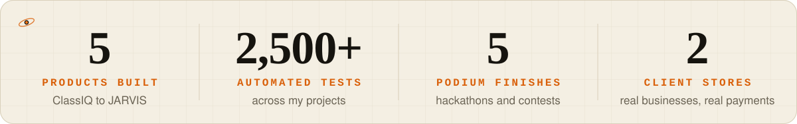
</picture>

## About

I build software that gets used: a classroom that writes its own quizzes from the lecture, a journal that remembers, a browser extension people keep their streaks in. TypeScript and Postgres by default, Python or Kotlin when the problem needs them. I use AI coding agents heavily. Architecture, tests and review are mine.

Currently looking for an **on-site software, backend or AI internship in Chennai**. Portfolio at [charan.loopfound.in](https://charan.loopfound.in/).

<picture>
  <source media="(prefers-color-scheme: dark)" srcset="./assets/brand/divider-dark.svg">
  <source media="(prefers-color-scheme: light)" srcset="./assets/brand/divider-light.svg">
  
</picture>

## Selected work

<table>
<tr>
<td width="50%" valign="top">
<a href="https://charan.loopfound.in/projects/classiq/">
<picture>
  <source media="(prefers-color-scheme: dark)" srcset="./assets/brand/card-classiq-dark.svg">
  <source media="(prefers-color-scheme: light)" srcset="./assets/brand/card-classiq-light.svg">
  
</picture>
</a>

<b>ClassIQ BenX Solutions</b> AI classroom platform. A Raspberry Pi records the lecture, speech-to-text for Indian languages and an LLM turn it into bilingual quizzes that run on students' phones. Multi-school admin, timed exams, AI grading help.

<b>Team of 4 · 500+ tests · CI/CD · Docker + Coolify</b> · private repo, walkthrough on request

<code>Express 5</code> <code>Socket.IO</code> <code>PostgreSQL</code> <code>BullMQ</code> <code>Next.js</code> <code>Raspberry Pi</code>

</td>
<td width="50%" valign="top">
<a href="https://charan.loopfound.in/projects/solace/">
<picture>
  <source media="(prefers-color-scheme: dark)" srcset="./assets/brand/card-solace-dark.svg">
  <source media="(prefers-color-scheme: light)" srcset="./assets/brand/card-solace-light.svg">
  
</picture>
</a>

<b>Solace <a href="https://solace-diaries.vercel.app">live</a> · <a href="https://github.com/NINJA981/Solace-Diaries">code</a></b> A private journal you can question. Semantic search with pgvector, and answers that cite the entries they came from. Entries are analysed in the background by a durable job queue.

<b>About 330 tests · row-level security · hybrid vector + keyword search</b>

<code>React 19</code> <code>Express 5</code> <code>Postgres + pgvector</code> <code>Gemini</code>

</td>
</tr>
<tr>
<td width="50%" valign="top">
<a href="https://charan.loopfound.in/projects/leetx/">
<picture>
  <source media="(prefers-color-scheme: dark)" srcset="./assets/brand/card-leetx-dark.svg">
  <source media="(prefers-color-scheme: light)" srcset="./assets/brand/card-leetx-light.svg">
  
</picture>
</a>

<b>LeetX Squads <a href="https://github.com/NINJA981/LeetX">code</a></b> Browser extension that turns LeetCode into a habit you keep with friends: streaks and freezes, spaced review, squads, 1v1 duels and automatic GitHub backup of every accepted solution.

<b>About 80 tests · Firebase rules tested on the emulator · CI-built Chrome and Firefox releases</b>

<code>JavaScript (MV3)</code> <code>Firebase</code> <code>GitHub Actions</code>

</td>
<td width="50%" valign="top">
<a href="https://charan.loopfound.in/projects/cryptotrace/">
<picture>
  <source media="(prefers-color-scheme: dark)" srcset="./assets/brand/card-cryptotrace-dark.svg">
  <source media="(prefers-color-scheme: light)" srcset="./assets/brand/card-cryptotrace-light.svg">
  
</picture>
</a>

<b>CryptoTrace <a href="https://cryptotrace-sand.vercel.app">live</a> · <a href="https://github.com/NINJA981/cryptotrace">code</a></b> Traces unknown crypto wallets through bounded transaction hops to the exchange that most likely holds them, with an explainable five-factor score and a requisition dossier.

<b>Built solo for Smart India Hackathon · tested · documented limits</b>

<code>FastAPI</code> <code>Next.js</code> <code>Etherscan / TronGrid</code>

</td>
</tr>
<tr>
<td width="50%" valign="top">
<a href="https://charan.loopfound.in/projects/jarvis/">
<picture>
  <source media="(prefers-color-scheme: dark)" srcset="./assets/brand/card-jarvis-dark.svg">
  <source media="(prefers-color-scheme: light)" srcset="./assets/brand/card-jarvis-light.svg">
  
</picture>
</a>

<b>JARVIS built with AI coding agents</b> Voice-first AI layer for Windows. One router across Claude, OpenAI, Gemini and Ollama with failover and budgets, a supervisor with eight specialist agents, a permission gate on every action and 11 MCP tool servers.

<b>1,100+ automated tests · Android companion</b> · private repo, demo on request

<code>TypeScript</code> <code>Electron</code> <code>MCP</code> <code>Ollama</code>

</td>
<td width="50%" valign="top">
<a href="https://charan.loopfound.in/">
<picture>
  <source media="(prefers-color-scheme: dark)" srcset="./assets/brand/card-visionnav-dark.svg">
  <source media="(prefers-color-scheme: light)" srcset="./assets/brand/card-visionnav-light.svg">
  
</picture>
</a>

<b>VisionNav</b> On-device Android navigation for blind and low-vision pedestrians: walking routes, live camera hazard detection and crossing awareness through voice and haptics. It never claims a road is safe.

<b>500+ unit tests on the core</b> · field testing in progress

<code>Kotlin</code> <code>CameraX</code> <code>YOLOv8n</code> <code>LiteRT</code>

</td>
</tr>
</table>

<picture>
  <source media="(prefers-color-scheme: dark)" srcset="./assets/brand/divider-dark.svg">
  <source media="(prefers-color-scheme: light)" srcset="./assets/brand/divider-light.svg">
  
</picture>

## How it works

<b>ClassIQ: from a lecture to a quiz</b>

 
<picture>
  <source media="(prefers-color-scheme: dark)" srcset="./assets/brand/arch-classiq-dark.svg">
  <source media="(prefers-color-scheme: light)" srcset="./assets/brand/arch-classiq-light.svg">
  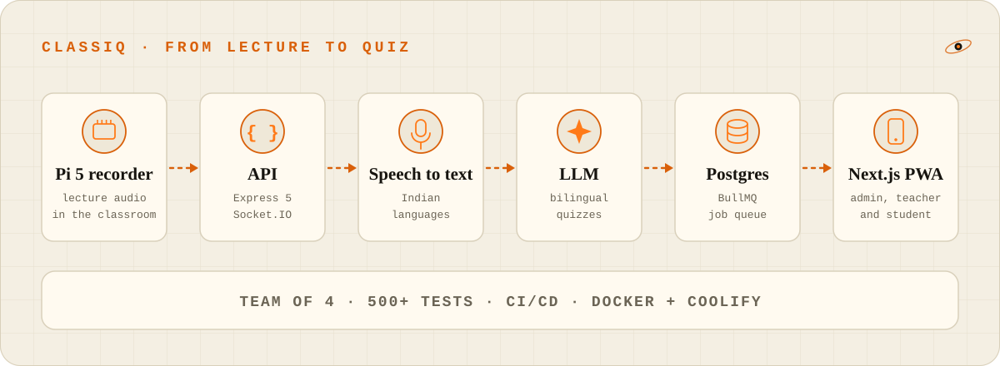
</picture>

<b>JARVIS: one voice command, many agents</b>

 
<picture>
  <source media="(prefers-color-scheme: dark)" srcset="./assets/brand/arch-jarvis-dark.svg">
  <source media="(prefers-color-scheme: light)" srcset="./assets/brand/arch-jarvis-light.svg">
  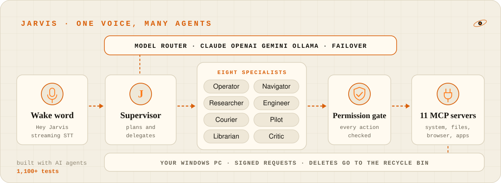
</picture>

<picture>
  <source media="(prefers-color-scheme: dark)" srcset="./assets/brand/divider-dark.svg">
  <source media="(prefers-color-scheme: light)" srcset="./assets/brand/divider-light.svg">
  
</picture>

## Client work

A production store built for a real business, with real payments:

<table>
<tr>
<td width="50%" valign="top">
<a href="https://charan.loopfound.in/">
<picture>
  <source media="(prefers-color-scheme: dark)" srcset="./assets/brand/card-methagu-dark.svg">
  <source media="(prefers-color-scheme: light)" srcset="./assets/brand/card-methagu-light.svg">
  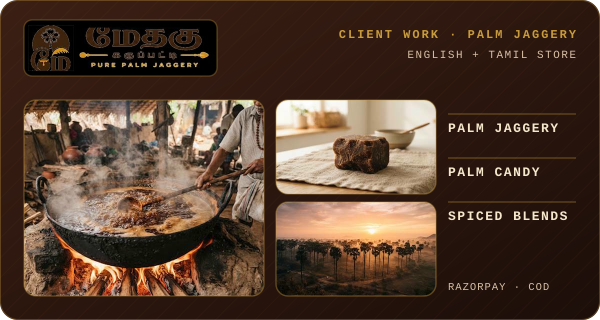
</picture>
</a>

<b>Methagu Karuppatti client work</b> Bilingual (English and Tamil) palm jaggery store. Razorpay and cash on delivery, coupons, refunds, GST invoices, admin analytics.

<b>about 73 tests · Playwright with accessibility checks · CSP, CSRF, rate limiting</b>

<code>Next.js</code> <code>Drizzle</code> <code>PostgreSQL</code> <code>Razorpay</code>

</td>
</tr>
</table>

**Also built:** [VADA](https://github.com/NINJA981/vada) (voice RAG with hybrid retrieval, benchmarked) · SafeCanteen (canteen pre-ordering, money and capacity rules in the database) · [ResponSync](https://github.com/NINJA981/RS) (flood-response digital twin, I built the backend) · OpenShield (dependency and licence risk scanner with SBOM export).

<picture>
  <source media="(prefers-color-scheme: dark)" srcset="./assets/brand/divider-dark.svg">
  <source media="(prefers-color-scheme: light)" srcset="./assets/brand/divider-light.svg">
  
</picture>

## Stack

<picture>
  <source media="(prefers-color-scheme: dark)" srcset="./assets/brand/stack-dark.svg">
  <source media="(prefers-color-scheme: light)" srcset="./assets/brand/stack-light.svg">
  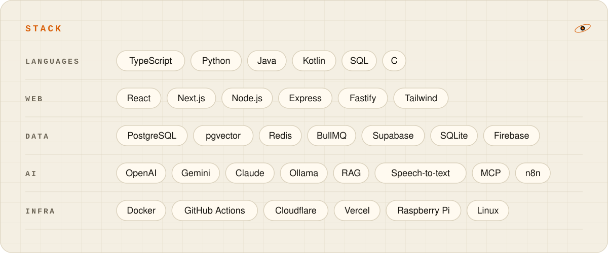
</picture>

<picture>
  <source media="(prefers-color-scheme: dark)" srcset="./assets/brand/divider-dark.svg">
  <source media="(prefers-color-scheme: light)" srcset="./assets/brand/divider-light.svg">
  
</picture>

## Wins

<picture>
  <source media="(prefers-color-scheme: dark)" srcset="./assets/brand/timeline-dark.svg">
  <source media="(prefers-color-scheme: light)" srcset="./assets/brand/timeline-light.svg">
  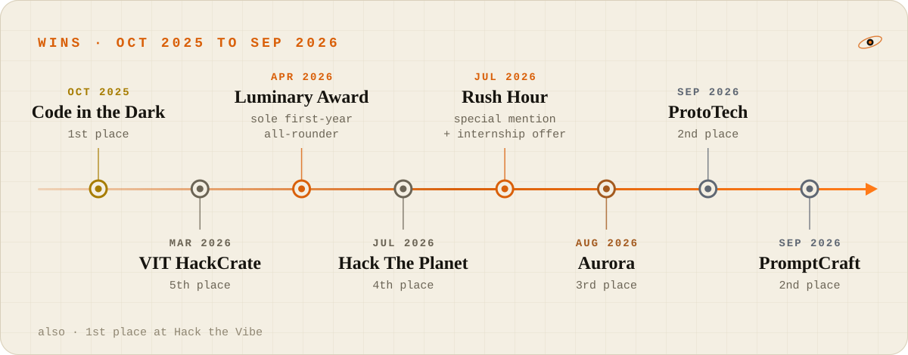
</picture>

The list, in text

- 1st: Hack the Vibe · Code in the Dark
- 2nd: ProtoTech · PromptCraft (TechnoSummit)
- 3rd: Aurora · 4th: Hack The Planet · 5th: VIT HackCrate
- Special Mention at Rush Hour, with an internship offer
- Luminary Award: sole all-rounder of the first-year batch
- Instructor (n8n workshop), speaker (WebXplore), organiser (CodeStorm, Crackathon), started the Forge developer community

<picture>
  <source media="(prefers-color-scheme: dark)" srcset="./assets/brand/divider-dark.svg">
  <source media="(prefers-color-scheme: light)" srcset="./assets/brand/divider-light.svg">
  
</picture>

## Live

<!-- LANG:START -->
<picture>
  <source media="(prefers-color-scheme: dark)" srcset="./assets/live/languages-dark.svg?v=aea94385">
  <source media="(prefers-color-scheme: light)" srcset="./assets/live/languages-light.svg?v=aea94385">
  
</picture>
<!-- LANG:END -->

**Recently shipped** (public repositories, refreshed automatically)

<!-- ACTIVITY:START -->
- **[Solace-Diaries](https://github.com/NINJA981/Solace-Diaries)**: api: Brevo mail transport; web: daily keep-alive cron · 3 days ago
- **[hf21lm5](https://github.com/NINJA981/hf21lm5)**: Deploy on Vercel as static site + Python function; add live link · 6 days ago
<!-- ACTIVITY:END -->

<b>Play Connect-4 against my bot</b>

 

<!-- C4:START -->

<picture>
  <source media="(prefers-color-scheme: dark)" srcset="./assets/game/board-dark.svg?v=6">
  <source media="(prefers-color-scheme: light)" srcset="./assets/game/board-light.svg?v=6">
  
</picture>

**Your move!** You are orange. Pick a column to drop your disc.

[1](https://github.com/NINJA981/NINJA981/issues/new?title=c4%7Cmove%7C1&body=Just+press+%22Submit+new+issue%22.+The+move+is+played+automatically.) &nbsp;·&nbsp; [2](https://github.com/NINJA981/NINJA981/issues/new?title=c4%7Cmove%7C2&body=Just+press+%22Submit+new+issue%22.+The+move+is+played+automatically.) &nbsp;·&nbsp; [3](https://github.com/NINJA981/NINJA981/issues/new?title=c4%7Cmove%7C3&body=Just+press+%22Submit+new+issue%22.+The+move+is+played+automatically.) &nbsp;·&nbsp; [4](https://github.com/NINJA981/NINJA981/issues/new?title=c4%7Cmove%7C4&body=Just+press+%22Submit+new+issue%22.+The+move+is+played+automatically.) &nbsp;·&nbsp; [5](https://github.com/NINJA981/NINJA981/issues/new?title=c4%7Cmove%7C5&body=Just+press+%22Submit+new+issue%22.+The+move+is+played+automatically.) &nbsp;·&nbsp; [6](https://github.com/NINJA981/NINJA981/issues/new?title=c4%7Cmove%7C6&body=Just+press+%22Submit+new+issue%22.+The+move+is+played+automatically.) &nbsp;·&nbsp; [7](https://github.com/NINJA981/NINJA981/issues/new?title=c4%7Cmove%7C7&body=Just+press+%22Submit+new+issue%22.+The+move+is+played+automatically.)

Games played 0 · Visitor wins 0 · Bot wins 0 · Draws 0 · Last move by @NINJA981

<!-- C4:END -->

<picture>
  <source media="(prefers-color-scheme: dark)" srcset="./assets/brand/divider-dark.svg">
  <source media="(prefers-color-scheme: light)" srcset="./assets/brand/divider-light.svg">
  
</picture>

## Contact

<picture>
  <source media="(prefers-color-scheme: dark)" srcset="./assets/brand/contact-dark.svg">
  <source media="(prefers-color-scheme: light)" srcset="./assets/brand/contact-light.svg">
  
</picture>

<a href="mailto:saicharan312008@gmail.com"><picture>
  <source media="(prefers-color-scheme: dark)" srcset="./assets/brand/btn-email-dark.svg">
  <source media="(prefers-color-scheme: light)" srcset="./assets/brand/btn-email-light.svg">
  
</picture></a>
<a href="https://www.linkedin.com/in/sai-charan111/"><picture>
  <source media="(prefers-color-scheme: dark)" srcset="./assets/brand/btn-linkedin-dark.svg">
  <source media="(prefers-color-scheme: light)" srcset="./assets/brand/btn-linkedin-light.svg">
  
</picture></a>
<a href="https://charan.loopfound.in/"><picture>
  <source media="(prefers-color-scheme: dark)" srcset="./assets/brand/btn-portfolio-dark.svg">
  <source media="(prefers-color-scheme: light)" srcset="./assets/brand/btn-portfolio-light.svg">
  
</picture></a>
<a href="https://github.com/NINJA981"><picture>
  <source media="(prefers-color-scheme: dark)" srcset="./assets/brand/btn-github-dark.svg">
  <source media="(prefers-color-scheme: light)" srcset="./assets/brand/btn-github-light.svg">
  
</picture></a>
<a href="https://leetcode.com/NINJA981/"><picture>
  <source media="(prefers-color-scheme: dark)" srcset="./assets/brand/btn-leetcode-dark.svg">
  <source media="(prefers-color-scheme: light)" srcset="./assets/brand/btn-leetcode-light.svg">
  
</picture></a>
<a href="https://charan.loopfound.in/Sai_Charan_CV.pdf"><picture>
  <source media="(prefers-color-scheme: dark)" srcset="./assets/brand/btn-resume-dark.svg">
  <source media="(prefers-color-scheme: light)" srcset="./assets/brand/btn-resume-light.svg">
  
</picture></a>

<picture>
  <source media="(prefers-color-scheme: dark)" srcset="./assets/brand/footer-dark.svg">
  <source media="(prefers-color-scheme: light)" srcset="./assets/brand/footer-light.svg">
  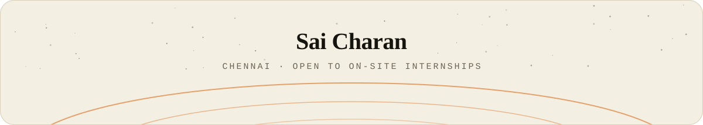
</picture>

